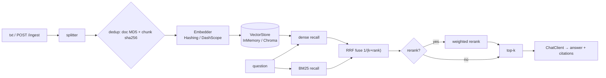

# rag-kb-pro · Local Knowledge-Base RAG (secondary development)

> **Upstream**: [lhh737/KnowledgeBase-RAG-LLM-System](https://github.com/lhh737/KnowledgeBase-RAG-LLM-System) (MIT).
> This repo is a **secondary development** of that Streamlit + Chroma + LangChain demo:
> layers were rebuilt, hybrid retrieval and an evaluation harness were added, and the
> whole core pipeline was made runnable **offline with zero third-party dependencies**.
> The original code is kept verbatim under [`upstream/`](./upstream); see [LICENSE](./LICENSE).

## What it is

A RAG service for an e-commerce customer-support knowledge base:

- **Ingest** — recursive splitting, two-level dedup (document MD5 + chunk sha256), pluggable embedder, optional Chroma persistence.
- **Retrieve** — `dense` / `bm25` / `hybrid` (Reciprocal Rank Fusion) / `hybrid+rerank`.
- **Generate** — `ChatClient` interface: `EchoChatClient` (offline) or `DashScopeChatClient` (OpenAI-compatible endpoint).
- **Serve** — FastAPI: `POST /ingest`, `POST /query`, `GET /healthz`.
- **Evaluate** — 28 Chinese questions, Top-1 / Top-3 / MRR / keyword-hit@3, one command → `eval/results.md`.



## Quick start (offline, no API key)

```bash
python -m pip install -e ".[dev]"   # core pipeline needs no deps at all
python -m pytest tests -q            # 63 passed
python eval/run_eval.py              # writes eval/results.md
```

Real-API mode:

```bash
export RAGKB_EMBEDDER=dashscope RAGKB_CHAT_CLIENT=dashscope
export RAGKB_DASHSCOPE_API_KEY=sk-xxxx
export RAGKB_STORE_BACKEND=chroma    # pip install -e ".[chroma]"
python -m ragkb --port 8000
```

## Measured results (HashingEmbedder + InMemoryStore, 28 questions, 3 docs / 17 chunks, top_k=3)

| config | Top-1 | Top-3 | MRR | keyword-hit@3 |
| --- | --- | --- | --- | --- |
| dense | 75.0% | 96.4% | 0.851 | 75.0% |
| bm25 | 92.9% | 100.0% | 0.964 | 82.1% |
| **hybrid** | **92.9%** | **100.0%** | **0.964** | **89.3%** |
| hybrid+rerank | 89.3% | 100.0% | 0.946 | 89.3% |

Read it honestly:

- `HashingEmbedder` has **no semantics** (character n-grams hashed into a fixed dimension). The `dense` column measures *lexical* similarity, not vector semantics.
- `source`-level hits are coarse (any chunk of the right file counts) — that is why Top-3 saturates at 100%. `keyword-hit@3` is the strict column.
- `hybrid+rerank` **loses** 3.6pt of Top-1: the BM25 weight (`w=0.4`) is not tuned and shows no stable gain on this corpus. Reported as measured, not fixed.

## Differences from upstream

| area | upstream | here |
| --- | --- | --- |
| deps | langchain stack + `numpy<2` + `chromadb<0.5` (unresolvable on new Python) | zero deps for the core; `fastapi` / `chromadb` are optional extras |
| vendor | `DashScopeEmbeddings` / `ChatTongyi` version-locked | OpenAI-compatible endpoint, swap vendor by changing `base_url` |
| metadata bug | `add_texts(metadata=...)` silently swallowed by `**kwargs` → no `source` | explicit `metadatas=` + regression test |
| `similarity_threshold` | misnamed, actually used as `k` | split into `top_k` and `dense_min_score` |
| dedup | document MD5 only | document MD5 **+** chunk-level sha256 |
| retrieval | single vector search, `k=1` | dense / bm25 / hybrid (RRF) / hybrid+rerank |
| testability | Streamlit pages, manual | FastAPI + 63 offline pytest cases |
| evaluation | none | `eval/run_eval.py` → reproducible markdown table |

## Known limitations

- Character-level chunking has no notion of headings; a title can land in a different chunk than its body.
- BM25 uses character bigrams instead of a dictionary-based tokenizer — no synonyms, no morphology.
- Rerank is BM25-score weighting inside the candidate pool; it cannot recover chunks that were never recalled.
- `InMemoryStore` is brute-force (O(N·d)); fine for thousands of chunks, not millions.
- `ChromaStore` was **not executed** in this environment (chromadb install failed on Python 3.14) — code only, unverified.
- No auth, no streaming.

## Next steps

1. Re-run the same question set with real embeddings (`text-embedding-v4` / `bge-m3`) and publish the baseline-vs-real comparison.
2. Grid-search `rerank_bm25_weight` and `candidate_k`; replace the reranker with a cross-encoder.
3. Structure-aware splitting (markdown headings first, character fallback).
4. Service hardening: auth, SSE streaming, Chroma integration tests.

## License

MIT. Upstream copyright notice kept intact in [LICENSE](./LICENSE); upstream code lives under `upstream/`.