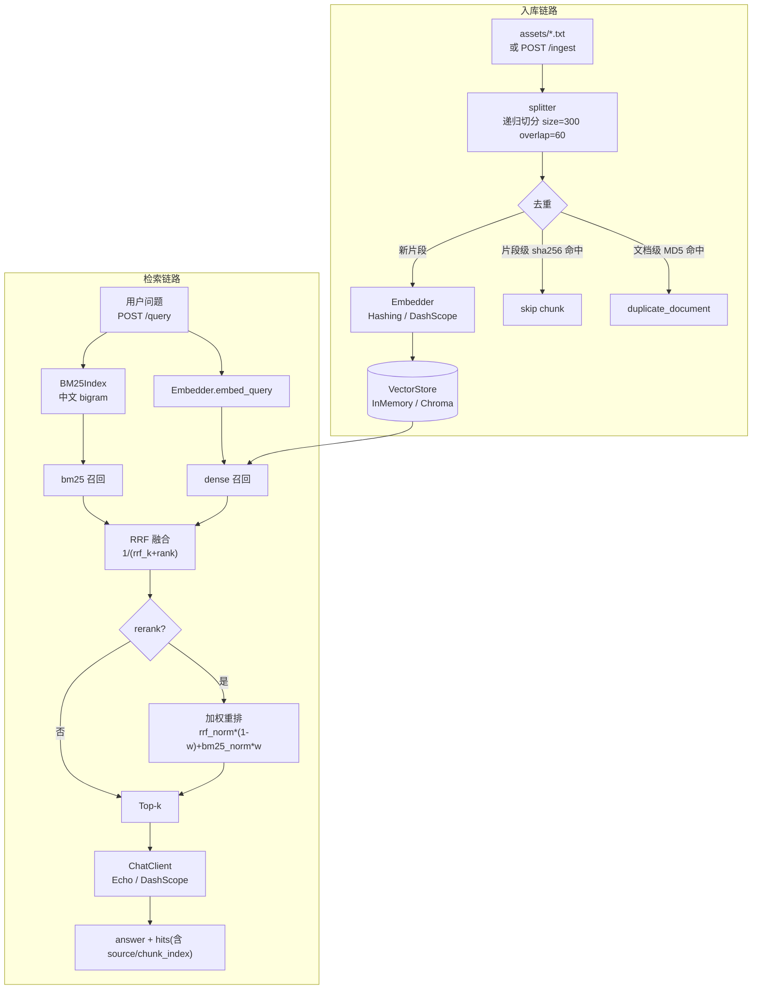

# rag-kb-pro · 本地知识库 RAG（二次开发版）

> **上游项目**：[lhh737/KnowledgeBase-RAG-LLM-System](https://github.com/lhh737/KnowledgeBase-RAG-LLM-System)（MIT）
> **本仓库定位**：在上游「Streamlit + Chroma + LangChain」复现项目的基础上做**二次开发**，
> 重做工程分层、补齐混合检索与评测脚手架，并把它改造成可以脱离 API Key、脱离第三方依赖跑通的形式。
> 上游代码原样保留在 [`upstream/`](./upstream) 供对照，版权与 MIT 协议见 [LICENSE](./LICENSE)。

---

## 1. 这是什么

一个面向「电商客服知识库」的 RAG 检索问答工程：

- **入库**：上传 txt → 递归切分 → 向量化 → 写向量库，带文档级 + 片段级两层去重；
- **检索**：`dense`（向量）/ `bm25`（词法）/ `hybrid`（RRF 融合）/ `hybrid+rerank` 四种可切换配置；
- **生成**：`ChatClient` 抽象，离线用 `EchoChatClient`，接真实模型用 `DashScopeChatClient`；
- **服务**：FastAPI 提供 `POST /ingest`、`POST /query`、`GET /healthz`；
- **评测**：28 条中文问题集 + Top-1 / Top-3 / MRR / 关键词命中@3 指标，一条命令产出 Markdown 报告。

关键点：**核心链路（切分 / BM25 / RRF / 去重 / 评测）只用 Python 标准库**，
因此 `pytest` 可以在完全不联网、不装 numpy、不填 API Key 的机器上跑绿。

## 2. 架构



分层与文件一一对应，没有隐式全局状态：

| 模块 | 职责 |
| --- | --- |
| `ragkb/config.py` | `RAGConfig` dataclass + `RAGKB_*` 环境变量覆盖 |
| `ragkb/text.py` | 归一化 + 中文字符 n-gram 分词（BM25 与向量共用同一口径） |
| `ragkb/splitter.py` | 递归切分（纯标准库复刻 `RecursiveCharacterTextSplitter` 行为） |
| `ragkb/embedding.py` | `Embedder` 接口 + `HashingEmbedder`（离线）/ `DashScopeEmbedder`（真实），含批量与重试 |
| `ragkb/store.py` | `VectorStore` 抽象 + `InMemoryStore` / `ChromaStore` |
| `ragkb/bm25.py` | 纯 Python BM25（Okapi），中文 bigram |
| `ragkb/retriever.py` | dense / bm25 / hybrid + RRF + 轻量重排 |
| `ragkb/chat.py` | `ChatClient` + `EchoChatClient` / `DashScopeChatClient` |
| `ragkb/pipeline.py` | ingest / query 编排，两层去重 |
| `ragkb/service.py` | FastAPI 服务层（Pydantic 出入参） |

## 3. 与上游的差异

| 维度 | 上游 | 本仓库 | 为什么改 |
| --- | --- | --- | --- |
| 依赖 | `langchain` 全家桶 + `numpy<2` + `chromadb<0.5`，新 Python 上 `ResolutionImpossible` | 核心链路 **零第三方依赖**；`fastapi` / `chromadb` 都是可选 extra | 上游依赖钉死版本组合，装不上就不可复现 |
| 厂商绑定 | `DashScopeEmbeddings` / `ChatTongyi`（随社区包版本绑死） | 走 OpenAI 兼容端点 `/compatible-mode/v1`，换厂商只改 `base_url` | 厂商标 · 依赖链更短 |
| 元数据 | `add_texts(metadata=...)` 单数参数被 `**kwargs` 静默吞掉 → `source` 全空 | 显式 `metadatas=`，并有回归测试锁死；`Chunk` 强制 metadata 可回读 | 元数据是"来源可追溯"和评测的前提 |
| `similarity_threshold` | 名字是阈值，实际当 `k` 用 | 拆成 `top_k`（返回几条）+ `dense_min_score`（余弦下限，低于不召回） | 命名误导会导致"永远硬凑 k 条垃圾上下文" |
| 去重 | 只有文档级 MD5（重复上传返回 `[Repeat]`） | 文档级 MD5 **+** 片段级 sha256；不同文件里的相同段落只存一份 | 文档级太粗，重复段落会白占 top-k 名额 |
| 检索 | 单一向量检索，`k=1` | dense / bm25 / hybrid（RRF）/ hybrid+rerank | 中文短查询里词法信号很强，单路向量不稳 |
| 可测性 | Streamlit 页面，只能肉眼看 | FastAPI + pytest（57 用例，离线全绿） | 页面点不出回归测试 |
| 评测 | 无 | `eval/questions.jsonl` + `eval/run_eval.py`，产出可复现表格 | 没有数字就没法谈优化 |
| 交付形态 | 两个 Streamlit 页面 | HTTP 服务 + 可 install 的 Python 包 | 能被其它服务调用，也能进 CI |

## 4. 快速开始

### 4.1 离线模式（推荐先用这个跑通，不需要 API Key）

```bash
git clone <your-repo-url> && cd rag-kb-pro
python -m pip install -e ".[dev]"   # 只想装 pytest；核心链路本来就零依赖

python -m pytest tests -q            # 本机实测：63 passed（未装 fastapi 时 57 passed, 1 skipped）
python eval/run_eval.py              # 产出 eval/results.md（四配置对比表）
```

直接用 Python 跑通入库 + 问答：

```bash
python - <<'PY'
from ragkb import RAGPipeline, load_config
pipe = RAGPipeline(config=load_config())          # 默认 hashing + memory + echo
pipe.ingest_dir("assets")
res = pipe.query("真丝连衣裙应该怎么洗？", top_k=3)
print(res.answer)
for h in res.hits:
    print(h.source, h.metadata["chunk_index"], round(h.score, 4))
PY
```

### 4.2 真实 API 模式（阿里云百炼 / 任何 OpenAI 兼容端点）

```bash
export RAGKB_EMBEDDER=dashscope
export RAGKB_CHAT_CLIENT=dashscope
export RAGKB_DASHSCOPE_API_KEY=sk-xxxx
export RAGKB_EMBEDDING_MODEL=text-embedding-v4
export RAGKB_CHAT_MODEL=qwen-plus
export RAGKB_STORE_BACKEND=chroma          # 需要 pip install -e ".[chroma]"
export RAGKB_PERSIST_DIR=./chroma_db
python -m pip install -e ".[api]"
python -m ragkb --host 127.0.0.1 --port 8000
```

```bash
curl -X POST http://127.0.0.1:8000/ingest \
  -H 'Content-Type: application/json' \
  -d '{"text":"真丝连衣裙建议干洗，水温不超过25度。","source":"洗涤养护.txt"}'

curl -X POST http://127.0.0.1:8000/query \
  -H 'Content-Type: application/json' \
  -d '{"question":"真丝连衣裙怎么洗","top_k":3,"mode":"hybrid","rerank":true}'
```

常用环境变量（全部字段都支持 `RAGKB_<FIELD_UPPER>`）：

| 变量 | 默认 | 说明 |
| --- | --- | --- |
| `RAGKB_EMBEDDER` | `hashing` | `hashing` / `dashscope` |
| `RAGKB_CHAT_CLIENT` | `echo` | `echo` / `dashscope` |
| `RAGKB_STORE_BACKEND` | `memory` | `memory` / `chroma` |
| `RAGKB_MODE` | `hybrid` | `dense` / `bm25` / `hybrid` |
| `RAGKB_TOP_K` / `RAGKB_CANDIDATE_K` | `3` / `10` | 返回条数 / 融合候选池 |
| `RAGKB_RERANK` / `RAGKB_RERANK_BM25_WEIGHT` | `false` / `0.4` | 是否重排 / BM25 归一化分权重 |
| `RAGKB_CHUNK_SIZE` / `RAGKB_CHUNK_OVERLAP` | `300` / `60` | 切分粒度 |
| `RAGKB_DENSE_MIN_SCORE` | `0.0` | 余弦下限，低于此值不召回 |

## 5. 评测结果

`python eval/run_eval.py` 的真实输出（HashingEmbedder + InMemoryStore，28 条中文问题，
语料 3 篇 / 3745 字 / 17 个片段，top_k=3）。完整报告见 [`eval/results.md`](./eval/results.md)。

| 配置 | Top-1 命中率 | Top-3 命中率 | MRR | 关键词命中@3 |
| --- | --- | --- | --- | --- |
| dense | 75.0% | 96.4% | 0.851 | 75.0% |
| bm25 | 92.9% | 100.0% | 0.964 | 82.1% |
| **hybrid** | **92.9%** | **100.0%** | **0.964** | **89.3%** |
| hybrid+rerank | 89.3% | 100.0% | 0.946 | 89.3% |

怎么读这张表（不美化）：

1. **`dense` 这一列不是"语义检索"的成绩。** `HashingEmbedder` 把字符 n-gram 哈希进固定维度，
   没有语义能力，它算出的相似度本质是"字面重合度平滑版"。所以 dense 拿到 75% 只能说明
   "字面相似排序不太差"，**不能**当作向量召回能力的证据。
2. **`source` 级命中偏松。** 同一份文档被切成 10 个片段，命中任意一个就算成功，
   所以 Top-3 全是 100% 。严格指标是最后一列「关键词命中@3」：命中片段里必须真的含目标文本。
3. **hybrid 相比 bm25 的收益主要体现在关键词命中@3（82.1% → 89.3%）**，
   Top-1 没变（92.9%）。原因是候选池只有 17 个片段、语料本身字面特征很强，
   向量一路主要在补"词法漏掉但字面相近"的召回。
4. **`hybrid+rerank` 的 Top-1 从 92.9% 掉到 89.3%。** 重排把 BM25 归一化分以 `w=0.4`
   加进 RRF 分里，池内名次被局部打乱，个别题被换到第 2 位。这是真实的负收益，
   说明**这组权重没调好 / 在这份语料上重排没有稳定增益**，不是"一定更好"的开关。
5. 平均耗时是单次查询的墙钟时间（含向量化 + 检索 + 可选重排），
   仅作参考 —— 本机 Python 3.14，量级在 1 ms 以下，没有做过性能优化。

补充一次 `--top-k 5` 的实测（同样 28 题，只是放宽返回条数）：

| 配置 | Top-1 | Top-5 | MRR | 关键词命中@5 |
| --- | --- | --- | --- | --- |
| dense | 75.0% | 100.0% | 0.860 | 82.1% |
| bm25 | 92.9% | 100.0% | 0.964 | 92.9% |
| **hybrid** | 92.9% | 100.0% | 0.964 | **96.4%** |
| hybrid+rerank | 89.3% | 100.0% | 0.946 | 96.4% |

放宽到 5 条后 hybrid 的关键词命中升到 96.4%（只剩 1 题没命中），说明**召回池够用、
瓶颈在排序**（Top-1 一直卡在 92.9%）。这也是"下一步先做重排调参、而不是继续加召回"的依据。

> 所有数字都是脚本实测出来的。换机器可复现（`blake2b` 哈希跨平台稳定）；
> 若某台机器跑不出来，本仓库宁可写"未运行"，也不填估算值。

## 6. 已知局限

- **切分是字符级启发式**：中文按 `。！？；，` + 换行递归切，不认语义/标题层级，
  小标题和正文可能被切到两个片段里（见失败案例 `q13`、`q14`）。
- **BM25 没有词典**：中文用字符 bigram/trigram 近似分词，不需要分词库但精度有限；
  "微胖 / 丰满"这类同义改写要靠向量，而离线 embedder 恰好不行。
- **重排不是模型重排**：只在候选池内用 BM25 分数加权重排，池里没有的片段救不回来；
  真正想提升应该上 `bge-reranker` 之类的交叉编码器，代价是 torch 与模型下载。
- **`InMemoryStore` 暴力检索**：O(N·d)，几百到几千片段够用，再往上要换 Chroma/FAISS。
- **`ChromaStore` 未在本机实跑**：本机 Python 3.14 装 `chromadb` 失败（见下节），
  该后端只有代码与接口，**没有实测记录**，接入前请自行验证。
- **去重仍是哈希级**：语义重复（改写过但意思一样）识别不了。
- **没有鉴权、没有流式输出**：`/ingest`、`/query` 裸奔，只适合内网/本地。

## 7. 环境与可复现性说明

- 本次开发环境：**Windows + Python 3.14.8**，`pytest 9.2.0`（`pypi.org` 直连安装成功）。
- 已装上：`pytest` / `fastapi 0.162.0` / `httpx 0.28.1` / `pydantic 2.14.2`，`pip install -e ".[dev]"` 构建 editable wheel 成功。
- 没装上：`chromadb` / `numpy` —— 本机网络（`mirrors.aliyun.com` DNS 解析失败）与 Python 3.14
  缺少预编译 wheel 双重原因。因此 `ChromaStore` **没有实测记录**，README 与 DESIGN 里
  都按"代码已写、未验证"标注，没有假称跑过。
- 测试集的降级行为是显式的：`tests/test_api.py` 在缺 `fastapi` 时用
  `pytest.importorskip` 整模块 skip（此时 `57 passed, 1 skipped`），
  装上后 `63 passed`（本机实测），核心用例从不依赖服务层。

## 8. 下一步

1. 换 `bge-m3` / `text-embedding-v4` 真实向量，重跑同一份 `eval/questions.jsonl`，
   得到"哈希基线 vs 真实向量"的对照数据（这才是能写进简历的那组数字）。
2. 把最后 5 题（跨文档 hard）拆成"多跳检索"：先检索材质、再检索配色，验证两段拼接是否提升。
3. `rerank` 换成交叉编码器或云端 rerank API，把 `w` 与 `candidate_k` 做小网格搜索。
4. 切分升级：按 Markdown 标题层级优先切，再退回字符切分。
5. 服务层补上鉴权、流式 SSE、以及 Chroma 后端的集成测试。

## 9. 目录结构

```
rag-kb-pro/
├── ragkb/                 # 二次开发主体（可 pip install）
│   ├── config.py  text.py  splitter.py  embedding.py
│   ├── store.py   bm25.py  retriever.py  chat.py
│   ├── pipeline.py  service.py  __main__.py
├── eval/
│   ├── questions.jsonl    # 28 条中文问题（含难度与 gold_source/gold_keyword）
│   ├── run_eval.py        # 四配置评测，写 results.md
│   └── results.md         # 实测报告（脚本生成，不手改）
├── tests/                 # 57 用例：切分/BM25/RRF/去重/元数据回归/端到端/API
├── upstream/              # 上游原版代码快照（对照用，未改动，保留版权头）
├── assets/                # 示例语料（3 篇 txt）+ 截图（png 未入库）
├── docs/DESIGN.md         # 关键取舍：为什么混合检索、RRF 怎么算、为什么可插拔
├── pyproject.toml  Makefile  .gitignore  .github/workflows/ci.yml
├── LICENSE                # MIT（上游版权声明保留）
├── README.md / README.en.md
```

## 10. 致谢与协议

- 上游：[lhh737/KnowledgeBase-RAG-LLM-System](https://github.com/lhh737/KnowledgeBase-RAG-LLM-System)，MIT，Copyright (c) to Rookie。
  本仓库对上游代码做了重构与功能扩展，`upstream/` 目录保留原样以便对照，`LICENSE` 原封不动保留上游版权声明。
- 参考：[Chroma](https://www.trychroma.com/) · [FastAPI](https://fastapi.tiangolo.com/) · [阿里云百炼 / Qwen](https://bailian.console.aliyun.com/)。
- 本仓库同样以 MIT 协议发布，二开部分版权归仓库作者所有。